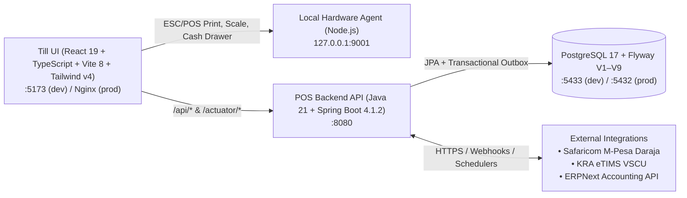

# Kenya Retail Supermarket POS & ERP System

An offline-first, enterprise-hardened **Point of Sale (POS), Inventory, Accounting, and Fiscal Compliance Platform** built specifically for Kenyan retail supermarkets.

The system integrates front-of-house till checkout (barcode scanning, weighing scales, 80mm thermal receipt printing, cash/M-Pesa STK/bank split payments), store-manager inventory & returns oversight, **KRA eTIMS** electronic tax invoicing, **Safaricom M-Pesa Daraja** payments, **ERPNext** General Ledger synchronization, and **Super Admin** audit/branch telemetry.

---

## Table of Contents

1. [Who Uses the System (Role-Based Workspaces)](#1-who-uses-the-system-role-based-workspaces)
2. [System Architecture & Tech Stack](#2-system-architecture--tech-stack)
3. [Repository Structure](#3-repository-structure)
4. [Key Features & Domain Workflows](#4-key-features--domain-workflows)
5. [Security & Compliance Controls](#5-security--compliance-controls)
6. [Local Development Quickstart](#6-local-development-quickstart)
7. [Production Deployment & DevOps](#7-production-deployment--devops)
8. [Testing & Verification](#8-testing--verification)
9. [Additional Documentation](#9-additional-documentation)

---

## 1. Who Uses the System (Role-Based Workspaces)

Every authenticated user is scoped strictly to their assigned role in `RoleAuthPortal`:

| Role | Access Level | Primary Responsibilities |
|---|---|---|
| **Cashier** (`CASHIER`) | Till Register Only | Open/close till shifts, scan standard & price/weight-embedded barcodes, capture live scale weights, manage held baskets, apply manager-authorized discounts/voids, process **Cash**, **M-Pesa STK Push**, **Bank/PDQ**, and **Split Tender** checkouts, award/redeem customer loyalty points, print ESC/POS receipts, and queue sales offline during internet outages. *(New cashier self-registrations start as `PENDING_APPROVAL` until authorized by a Manager/Super Admin.)* |
| **Admin / Manager** (`SUPERVISOR`) | Store Oversight | Authorize or disable pending cashier accounts, reset locked cashier PINs, manage product catalog pricing & KRA VAT tax categories (`A`/`B`/`C`/`E`), receive supplier stock with **FEFO** batch/expiry tracking, process item returns & KRA credit notes, monitor live shifts, and enter supervisor PINs for till overrides. |
| **Super Admin** (`SUPER_ADMIN`) | Enterprise Oversight | Provision privileged accounts (`SUPERVISOR` / `SUPER_ADMIN`), manage multi-branch shops & till lanes, configure & test **ERPNext** General Ledger integration (AES-256-GCM encrypted credentials), inspect immutable security audit logs, monitor KRA eTIMS outbox queues, download tax invoices, and configure **TOTP Two-Factor Authentication (2FA)**. |

---

## 2. System Architecture & Tech Stack



### Technology Stack

- **Backend (`backend/`)**: Java 21, Spring Boot 4.1.2 (WebMVC, Spring Data JPA, Spring Security, Validation, Actuator), Flyway migrations (`V1`–`V9`), PostgreSQL 17.
- **Frontend (`till-ui/`)**: React 19, TypeScript, Vite 8, Tailwind CSS v4, IndexedDB + `localStorage` offline sale queue & catalog cache.
- **Hardware Bridge (`hardware-agent/`)**: Zero-dependency Node.js local service bridging the browser UI to 80mm ESC/POS thermal printers, cash drawers, and RS-232/USB weighing scales.
- **Infrastructure (`infra/`)**: Docker Compose (dev DB + production stack), Nginx TLS 1.3 reverse proxy, Prometheus scrape config, PostgreSQL backup & self-signed LAN certificate scripts, GitHub Actions CI & Security pipelines.

---

## 3. Repository Structure

```text
supermarketPOS/
├── backend/                          # Spring Boot 4 / Java 21 REST API & schedulers
│   ├── src/main/java/ke/retailpos/pos_backend/
│   │   ├── accounting/               # EOD summaries, ERPNext client & journal entry poster
│   │   ├── audit/                    # Immutable audit logging service & query API
│   │   ├── auth/                     # JWT login/logout, PIN policy, rate limiter, TOTP MFA, override tokens
│   │   ├── branch/                   # Multi-branch shops & till lane registry
│   │   ├── config/                   # SecurityConfig, JwtService, JwtAuthFilter, AES-GCM secret encryption
│   │   ├── customer/                 # Customer loyalty registration, phone lookup & PII masking
│   │   ├── inventory/                # Stock receiving, FEFO product batches & expiry tracking
│   │   ├── outbox/                   # Transactional outbox background processor (KRA eTIMS)
│   │   ├── pricing/                  # VAT-inclusive HALF_UP cart & tax extraction engine
│   │   ├── product/                  # Catalog CRUD, barcode lookup, EAN-13 weight/price barcode parser
│   │   ├── providers/                # Daraja M-Pesa STK Push, webhook & fallback reconciliation; eTIMS VSCU
│   │   ├── reports/                  # Daily sales summaries & tax invoice exports
│   │   ├── returns/                  # Return processing, stock restocking & KRA credit notes
│   │   ├── sales/                    # Checkout service, idempotent offline replay & split payments
│   │   └── shift/                    # Cashier shift open/close & cash float reconciliation
│   ├── src/main/resources/
│   │   ├── application.yml           # Runtime configuration & environment variable bindings
│   │   └── db/migration/             # Flyway schema & hardening migrations (V1–V9)
│   ├── Dockerfile
│   └── run-backend.sh                # Safely frees :8080 and launches backend
├── till-ui/                          # React + TypeScript + Tailwind POS interface
│   ├── src/
│   │   ├── components/               # Till terminal, Checkout, Receipt, Manager, Super Admin, Auth UI
│   │   └── utils/                    # Authenticated fetch wrapper, offline queue integrity, toast/audio
│   ├── Dockerfile
│   └── vite.config.ts                # Dev server (:5173) proxying /api and /actuator to :8080
├── hardware-agent/                   # Local Node.js peripheral agent (:9001)
│   ├── index.js                      # HTTP server (/health, /scale/weight, /print, /drawer/open)
│   ├── escpos.js                     # 80mm thermal receipt ESC/POS byte formatter
│   └── scale.js                      # Weighing scale parser & simulator
├── infra/                            # Docker, Nginx TLS, Prometheus & operational scripts
│   ├── docker-compose.yml            # Local PostgreSQL 17 dev container on port 5433
│   ├── docker-compose.prod.yml       # Full production stack (DB + API + UI + Nginx TLS)
│   ├── nginx/nginx.conf              # TLS 1.3 reverse proxy & security headers
│   └── scripts/                      # backup-postgres.sh & generate-self-signed-certs.sh
├── docs/                             # Architecture, Kenya tax rules, Daraja & security docs
├── .github/workflows/                # ci.yml (Maven, lint, build) & security.yml (Gitleaks, npm audit, Trivy)
└── start-dev.sh                      # One-command local dev launcher (DB + Agent + Backend + UI)
```

---

## 4. Key Features & Domain Workflows

### Kenyan VAT & KRA eTIMS Fiscal Compliance
- Shelf prices in Kenyan retail are **VAT-inclusive**. [PricingService](backend/src/main/java/ke/retailpos/pos_backend/pricing/PricingService.java) extracts net taxable amounts and VAT using `BigDecimal` (`RoundingMode.HALF_UP`) across Kenya tax categories:
  - **Category A (`16%`)** — Standard VAT (packaged goods, detergents, electronics, confectionery)
  - **Category B (`0%`)** — Zero-rated (unflavoured milk, ordinary bread, maize/wheat flour, LPG)
  - **Category C (`8%`)** — Special rate
  - **Category E (`0%`)** — Exempt (medicaments, unprocessed agricultural produce)
- **Transactional Outbox (`outbox` table)**: Every sale or return atomically commits `etims.invoice.queued` or `etims.credit_note.queued` in PostgreSQL inside the sale transaction so checkouts never stall if KRA VSCU is temporarily unreachable.

### Checkout, Split Tender & Offline Resilience
- **Barcodes & Scales**: Supports standard EAN/UPC scans plus variable-weight/price-embedded supermarket barcodes (prefix `20`–`29`) and live serial/USB weighing scale reads via `hardware-agent`.
- **Payment Modes**: Single tender (**Cash**, **M-Pesa STK Push**, **Bank/PDQ**) or **Split Tender** (e.g., partial Cash + M-Pesa), plus loyalty point earning (1 token per KES 100 spent) and redemption.
- **Daraja STK Reconciliation**: When M-Pesa webhooks are delayed on unstable ISP connections, [MpesaReconciliationJob](backend/src/main/java/ke/retailpos/pos_backend/providers/payment/MpesaReconciliationJob.java) polls `PENDING_STK` transactions via Daraja `STKQuery` when `pos.mpesa.enabled=true`.
- **Offline Queue**: Failed network checkouts are persisted locally (`localStorage` + IndexedDB) with an integrity seal and idempotent `clientSaleId` UUIDs, then automatically replayed to `POST /api/sales` once connectivity returns.

### Inventory, FEFO Batches & ERPNext Accounting
- **Stock Receiving & FEFO**: Managers receive supplier deliveries with batch numbers and expiry dates; sales automatically deduct batches First-Expired-First-Out (**FEFO**).
- **ERPNext GL Integration**: EOD summaries post balanced Journal Entries to ERPNext (or queue into `outbox` if offline), and supplier stock receipts can post Purchase Invoices directly.

---

## 5. Security & Compliance Controls

All critical POS, API, database, and DevOps controls are built in and verified:

- **Stateless JWT Auth + Immediate Logout Revocation**: Tokens carry a unique `jti` claim (`1h` default TTL via `POS_JWT_TTL_SECONDS`). Calling `POST /api/auth/logout` records the token `jti` in PostgreSQL `revoked_token`, causing `JwtAuthFilter` to reject subsequent reuse immediately.
- **Opt-In RFC 6238 TOTP 2FA**: Super Admins (and any authenticated user) can enroll Google Authenticator / Authy via `/api/auth/mfa/setup` & `/api/auth/mfa/enable`.
- **PIN Policy & Brute-Force Lockout**: `PinPolicy` enforces ≥ 6 non-trivial characters on new registrations and PIN resets; `LoginRateLimiter` locks accounts after 5 failed login or supervisor-override attempts.
- **Server-Authoritative Catalog Pricing & Single-Use Override Tokens**: `SaleService` always prices items from the database catalog (`product.getPriceKes()`) and rejects unapproved price tampering or discounts (`discountKes > 0`) unless accompanied by a valid, unexpired, single-use `SupervisorOverrideToken` issued by `/api/auth/verify-supervisor-override` and consumed on checkout.
- **Immutable Audit Trail (`trg_audit_log_immutable`)**: Flyway migration `V9` installs a PostgreSQL `BEFORE UPDATE OR DELETE` trigger on `audit_log` preventing tampering with security, login, override, product-edit, stock, and user-management logs.
- **Customer PII Protection & Pagination Caps**: Bulk `GET /api/customers` is restricted to `SUPERVISOR` / `SUPER_ADMIN` with phone numbers masked (`0712***678`), while checkout lookup `/api/customers/by-phone/{phone}` stays available to cashiers. Collection endpoints cap page sizes at `500`.
- **Spoofing & Secret Hygiene**:
  - `X-Forwarded-For` is ignored unless `POS_SECURITY_TRUST_FORWARDED_HEADERS=true` behind Nginx (`docker-compose.prod.yml`).
  - ERPNext API secrets are encrypted at rest with AES-256-GCM (`SecretEncryptionService`).
  - Production startup enforces ≥ 32-character non-default `POS_JWT_SECRET` / `POS_ENCRYPTION_KEY` when `POS_SECURITY_ENFORCE_STRONG_KEYS=true`.
  - HTTP responses enforce strict `Content-Security-Policy`, `X-Frame-Options: DENY`, and `Referrer-Policy: no-referrer`.

---

## 6. Local Development Quickstart

### Prerequisites
- **Docker** & **Docker Compose** (for PostgreSQL 17 on port `5433`)
- **Java 21** (Maven Wrapper `./mvnw` is included in `backend/`)
- **Node.js 22+** & **npm**

### Option A: One-Command Full Stack Startup (Recommended)
From the repository root:
```bash
./start-dev.sh
```
This script starts:
1. **PostgreSQL 17** via `infra/docker-compose.yml` on `localhost:5433` (`db=pos`, `user=pos`, `password=pos_dev_password`)
2. **Hardware Agent** via `node hardware-agent/index.js` on `http://127.0.0.1:9001`
3. **Spring Boot Backend** (`backend/`) on `http://127.0.0.1:8080` (waits until `/actuator/health` is `UP`)
4. **Till UI (Vite)** on `http://localhost:5173` (proxies `/api/*` and `/actuator/*` to `:8080`)

Pass `--restart` (`./start-dev.sh --restart`) if you want the script to stop and restart stale processes on ports `8080` / `9001`.

### Option B: Run Services Individually
```bash
# 1. Start PostgreSQL 17 (port 5433)
docker compose -f infra/docker-compose.yml up -d

# 2. Start Hardware Agent (port 9001)
node hardware-agent/index.js

# 3. Start Spring Boot Backend (port 8080; safely frees stale :8080 processes)
./backend/run-backend.sh

# 4. Start Frontend UI (port 5173)
cd till-ui && npm install && npm run dev
```

### First-Time Setup in the UI
1. Open **`http://localhost:5173`**.
2. On a fresh database with no active `SUPER_ADMIN`, select **Super Admin → Create Account** to bootstrap your first Super Admin account (subsequent self-registration of `SUPER_ADMIN` or `SUPERVISOR` is automatically blocked and must be provisioned by an authenticated Super Admin).
3. Cashiers can self-register (`PENDING_APPROVAL`) and become active once approved by a **Manager** or **Super Admin** in the Cashiers tab.

---

## 7. Production Deployment & DevOps

The production Docker stack is defined in [infra/docker-compose.prod.yml](infra/docker-compose.prod.yml):

1. Copy and configure environment secrets (never commit `.env`):
   ```bash
   cp infra/.env.example infra/.env
   cp backend/.env.example backend/.env
   ```
   Set strong `POSTGRES_PASSWORD`, a random 32+ character `POS_JWT_SECRET`, `POS_ENCRYPTION_KEY`, and optional `POS_MPESA_*` / `HARDWARE_TOKEN` values.
2. Generate LAN TLS certificates for Nginx (`infra/nginx/certs/`):
   ```bash
   ./infra/scripts/generate-self-signed-certs.sh
   ```
3. Launch the production stack behind Nginx TLS 1.3 (ports `80`/`443`, internal-only database network):
   ```bash
   docker compose --env-file infra/.env -f infra/docker-compose.prod.yml up -d --build
   ```
4. **Automated CI & Security Pipelines**:
   - [.github/workflows/ci.yml](.github/workflows/ci.yml): Maven `./mvnw -B verify`, `till-ui` lint (`oxlint`) + TypeScript & Vite build + `npm audit`, and `hardware-agent` syntax check.
   - [.github/workflows/security.yml](.github/workflows/security.yml): Weekly & push-triggered **Gitleaks** secret scanning, `npm audit --audit-level=high`, and **Trivy** filesystem vulnerability & misconfiguration scanning.
5. **Backups & Telemetry**:
   - Database backups: `./infra/scripts/backup-postgres.sh`
   - Health & metrics: `/actuator/health` (public status), `/actuator/metrics` & `/actuator/prometheus` (`SUPER_ADMIN` role; scrape config in [infra/prometheus.yml](infra/prometheus.yml)).

---

## 8. Testing & Verification

```bash
# Backend unit tests (no Docker/Testcontainers required)
cd backend && ./mvnw -B test -Dtest='!*IntegrationTest,!*ApplicationTests'

# Full backend verification including Testcontainers integration tests (requires Docker)
cd backend && ./mvnw -B verify

# Frontend lint & production build
cd till-ui && npm run lint && npm run build

# Hardware agent & shell script syntax checks
node -c hardware-agent/index.js
bash -n start-dev.sh backend/run-backend.sh infra/scripts/*.sh
```

---

## 9. Additional Documentation

- [System Architecture](docs/architecture.md) — Core data flows and architectural highlights
- [Kenyan Tax Rules & KRA eTIMS Specification](docs/kenya-tax-rules.md) — VAT categories (`A`, `B`, `C`, `E`), Half-Up extraction math & credit notes
- [Daraja M-Pesa Integration](docs/daraja-mpesa.md) — STK Push, callback verification & reconciliation setup
- [Roadmap & Security Architecture](docs/roadmap-and-security-architecture.md) — Competitor feature comparison & phased security design
- [Infrastructure & PostgreSQL Guide](infra/README.md) — Local DB credentials & Compose CLI commands
- [Hardware Agent Guide](hardware-agent/README.md) — Local printer & scale HTTP endpoints
