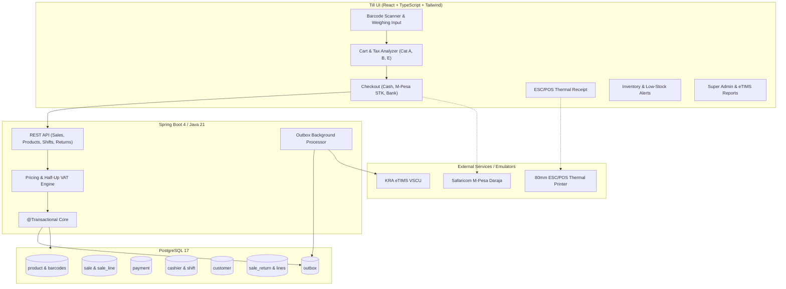

# Kenya Retail POS: System Architecture

## Key Architectural Highlights

1. **Inclusive Pricing & Rounding Precision**:
   - Shelf prices in Kenyan supermarkets are statutory VAT-inclusive.
   - We utilize `BigDecimal` with `RoundingMode.HALF_UP` and 3 decimal places for weighed items (kg) to prevent fractional cent imbalances.
   
2. **Offline-First Resilience (Transactional Outbox)**:
   - Supermarkets experience intermittent internet connectivity.
   - When a sale is made, the sale record, payment, and KRA eTIMS outbox task are committed atomically in PostgreSQL.
   - If offline, sales continue uninterrupted. When the connection resumes, the `OutboxProcessor` drains pending items to KRA VSCU.

3. **Role-Based Access Control**:
   - `CASHIER`: Scans items, manages shift, settles cash/M-Pesa.
   - `SUPERVISOR` / `MANAGER`: Modifies product prices, updates KRA tax categories, investigates low-stock alerts, authorizes returns.
   - `SUPER_ADMIN`: Inspects daily sales grouped by till, monitors outbox sync, exports monthly eTIMS tax invoices for KRA filing.
